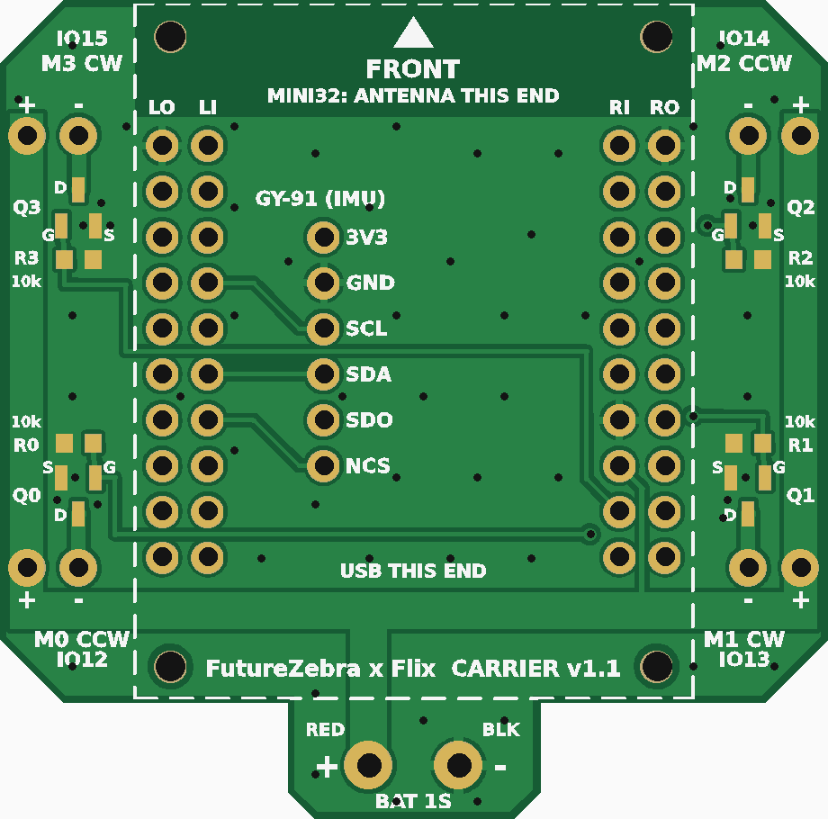

# FutureZebra × Flix 載板 v1.1（PCB）

把 Flix 手焊版的 4 顆 MOSFET、4 顆 10 kΩ 電阻做成一塊小板子，連同 MINI32 用的 4 條排母都交給 JLCPCB 焊好。
MINI32 直接插在上面，GY-91 照原樣鎖在機身、用 6 條短線接上來。電路和官方手焊版完全相同。



## 要交給 JLCPCB 的檔案（都在 `fab/`）

| 檔案 | 用途 |
| --- | --- |
| `fz-flix-carrier-gerber.zip` | 「Add gerber file」上傳這個 |
| `fz-flix-carrier-BOM.csv` | PCBA 步驟的 BOM |
| `fz-flix-carrier-CPL.csv` | PCBA 步驟的座標檔（CPL） |
| `MANUFACTURING-NOTES.pdf` | 中英文製造說明（廠商有問題時給他看） |
| `fz-flix-carrier-assembly.pdf` | 組裝圖 |
| `fz-flix-carrier-schematic.pdf` | 原理圖 |

`carrier-posts.stl` 是自己 3D 列印的支柱，不用給 JLC。

## JLCPCB 下單步驟

1. 打開 jlcpcb.com → **Order now** → **Add gerber file**，上傳 `fz-flix-carrier-gerber.zip`。
   系統應該自動讀到 **2 層、46 × 45.5 mm**。右邊的 Gerber Viewer 看一下：上層有白字 FRONT、四個角有 M0～M3。
2. PCB 選項（沒寫的用預設值）：

   | 選項 | 選 | 說明 |
   | --- | --- | --- |
   | Base Material | FR-4 | |
   | Layers | 2 | 自動 |
   | PCB Qty | 5 | 最少 5 片 |
   | Delivery Format | Single PCB | 不拼板 |
   | PCB Thickness | **1.0 mm** | 比 1.6 mm 輕約 2 g；選 1.6 也可以 |
   | PCB Color | Green | 綠色最便宜、最快；其他顏色也可以 |
   | Silkscreen | White | |
   | Surface Finish | **LeadFree HASL** | 學生要手焊，用無鉛 |
   | Outer Copper Weight | 1 oz | |
   | Via Covering | Tented | |
   | Mark on PCB | Remove Mark | 預設就是不加 |
   | 其他（金手指、半孔、阻抗…） | 不選 | |

3. 打開 **PCB Assembly**：

   | 選項 | 選 | 說明 |
   | --- | --- | --- |
   | PCBA Type | Economic | |
   | Assembly Side | **Top Side** | 只有正面有貼片 |
   | PCBA Qty | 2 或 5 | 最少 2 片；要全部貼就選 5 |
   | Tooling holes | Added by JLCPCB | |
   | Confirm Parts Placement | **Yes** | 工程師會先寄貼片圖給你確認方向 |

4. **Next** → 上傳 `fz-flix-carrier-BOM.csv`、`fz-flix-carrier-CPL.csv` → **Process BOM & CPL**。
5. 零件確認頁：應該配到 3 種料：
   - Q0,Q1,Q2,Q3 → **C20917** AO3400A（Basic）
   - R0,R1,R2,R3 → **C25804** 10 kΩ 0603（Basic）
   - H1,H2,H3,H4 → **C2905418** 1×10 排母 8.5 mm（穿孔，JLC 手焊；多收手焊費每單約 $3.5 + 每個焊點約 $0.017）
6. **貼片預覽（最重要）**：放大看 4 顆 MOSFET。每顆單獨的那一腳（3 腳 = D）要落在絲印「D」旁邊的焊墊上，也就是朝向同一角的馬達焊點；
   前面兩顆（Q2、Q3）朝前，後面兩顆（Q0、Q1）朝後。方向不對就在預覽裡把那顆轉 180°。
   4 條排母要蓋在 MINI32 的 4 排孔上（長邊前後方向）；如果是橫的，在預覽裡轉 90°。
7. 加入購物車、結帳。

> 這塊板子是用 Python 產生的（沒有 KiCad），已經做過自寫 DRC、連通檢查、兩套 Gerber 看圖軟體比對。
> JLC 的線上預覽和 DFM 是最後一關，上傳後請看一下再付款。

## 板子上有什麼

- **4 顆 MOSFET（Q0～Q3，AO3400A）+ 4 顆 10 kΩ（R0～R3）**：放在左右兩翼，MINI32 不會蓋住，學生看得到。絲印標了 G、D、S、GPIO 編號、馬達編號、轉向和正負極。
- **H1～H4**：MINI32 的 4 排 × 10 孔（2.54 mm），JLC 焊好 1×10 排母。MINI32 天線朝 FRONT、USB 朝後插上去。
- **J2**：GY-91 的 6 個焊點（3V3、GND、SCL、SDA、SDO、NCS）。
- **馬達焊點**：每角 2 個（+、−），從背面插線、正面焊。
- **電池焊點**：後方凸片上的 BAT+、BAT−（Ø1.3 mm 孔）。
- MINI32 天線下方兩面都不鋪銅，避免影響 Wi-Fi。

## 為什麼用 AO3400A，不用官方的 100N03A

官方的 UMW 100N03A 是 TO-252，在 JLC 是擴充零件（每種料多收換料費）。AO3400A 是 JLC 的基本零件、庫存很多，
3.3 V 就能完全導通（VGS(th) 最大 1.45 V；2.5 V 時 RDS(on) ≤ 48 mΩ），30 V / 5.7 A，每顆馬達 1～2 A 綽綽有餘。
Flix 作者提醒不要用 KIA 等其他廠的 100N03A（作者沒寫原因，推測是 3.3 V 打不開）；AO3400A 的規格書保證 2.5 V 就導通。
**還沒實機測試**，第一批板子到了先用 `mfl`、`mfr`、`mrl`、`mrr` 測四顆馬達。

## 安裝到機身

載板取代原本的 ESP32 支架：

1. 3D 列印 `fab/carrier-posts.stl`（PLA、0.2 mm、4 圈牆，約 1.1 g）。4 根柱子位置、高度（8 mm）和原支架柱腳一樣，底部用 2 mm 高的框連起來。
2. 用 4 顆 **M1.4×5** 從機身底面把支柱鎖上（同原本支架的孔）。
3. 載板放在柱子上，用另外 4 顆 **M1.4×5** 鎖下去（要先鎖，再插 MINI32）。
4. 總共需要 **8 顆 M1.4×5**（原本 4 顆）。

MINI32 插在 8.5 mm 高的排母上，會比原本高約 8 mm。想要重心低一點，可以不用排母、直接把 MINI32 的排針焊在載板上（不能再拆）。

## 重量（估計）

載板 1.0 mm 約 3.7 g、4 條排母約 2.4 g、支柱約 1.1 g；少了原本的支架（約 2 g）和手焊的 TO-252 MOSFET。整機大約多 4～5 g。

## 重新產生檔案

```bash
pip install shapely trimesh manifold3d matplotlib pygerber gerbonara scipy weasyprint markdown
cd pcb
python3 checks.py     # DRC + 連通檢查
python3 gerber.py     # Gerber、鑽孔、BOM、CPL、zip
python3 verify.py     # 用 pygerber 獨立算圖，和設計逐像素比對；產生 preview/render_*.png
python3 drawings.py   # 原理圖、組裝圖
python3 posts.py      # 3D 列印支柱 STL
python3 notes_pdf.py  # 製造說明 PDF
```

| 檔案 | 內容 |
| --- | --- |
| `design.py` | 所有尺寸、腳位、元件位置（改設計從這裡改） |
| `layout.py` | 焊墊、走線、過孔、鋪銅 |
| `silk.py` | 絲印 |
| `checks.py` | DRC 與連通檢查 |
| `gerber.py` | 輸出 Gerber / Excellon / BOM / CPL |
| `verify.py` | 獨立算圖比對 |
| `drawings.py` | 原理圖、組裝圖 |
| `posts.py` | 3D 列印支柱 |

座標：以機身中心為原點、+Y 機頭（和 `src/data.js`、機身 STL 一致）；輸出時平移到板子左下角 = (0, 0)。
