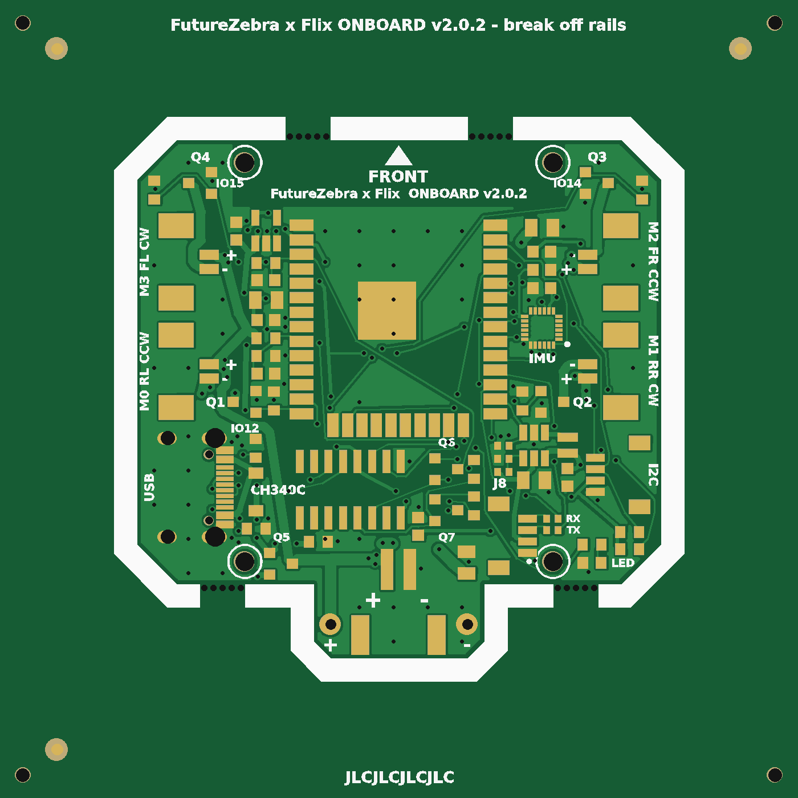

# FutureZebra × Flix 一體板 v2.0.2（免焊接版）

ESP32-WROOM-32E、ICM-40609-D IMU、CH340C USB 燒錄、AP2112K 3.3V 穩壓、4 路 AO3400A 馬達開關，全部由 JLCPCB 貼片。
學生只要插電池、插馬達（1.25 mm 2P 插頭）、裝槳。
v2.0.2 加了感測器插座 J8（JST SH 4P 立式：1 GND、2 5V、3 TX=IO17、4 RX=IO16，TX/RX 各串 1 kΩ），5V 由 TI TLV61070A 從 VSYS 升壓、IO4 控制開關（預設關），給 MicoAir MTF-02 光流測距模組用。機身與安裝方式和載板 v1.x 相同（鎖在原 ESP32 支架的 4 個柱腳位置，可用 `../pcb/fab/carrier-posts.stl`）。



## 要交給 JLCPCB 的檔案（`fab/`）

| 檔案 | 用途 |
| --- | --- |
| `fz-flix-onboard-gerber.zip` | 「Add gerber file」上傳這個（含鑽孔、工藝邊） |
| `fz-flix-onboard-BOM.csv` | PCBA 的 BOM |
| `fz-flix-onboard-CPL.csv` | PCBA 的座標檔 |
| `MANUFACTURING-NOTES.pdf` | 中英文製造說明（下單設定、方向檢查表、收板後測試） |
| `fz-flix-onboard-assembly.pdf` | 組裝圖 |
| `fz-flix-onboard-schematic.pdf` | 原理圖（接線表式） |

## Flix 韌體設定

燒官方 `flix.esp32.merged.bin` 後在主控台輸入：

```
p IMU_MODEL 4
p PWR_VOLT_PIN 33
p PWR_VOLT_LOW 3.5
```

馬達接腳與 IMU SPI 腳位都是 Flix 預設值，不用改。

## 重新產生

```
git clone --depth 1 --filter=blob:none --sparse https://github.com/KiCad/kicad-footprints.git /home/claude/kfp
cd /home/claude/kfp && git sparse-checkout set RF_Module.pretty Package_SO.pretty Package_TO_SOT_SMD.pretty Diode_SMD.pretty \
   Resistor_SMD.pretty Capacitor_SMD.pretty LED_SMD.pretty Connector_USB.pretty Connector_JST.pretty Connector_Molex.pretty Sensor_Motion.pretty
pip install shapely "pygerber<3" scipy pillow matplotlib weasyprint markdown
cd pcb2
python3 board.py      # 擺放檢查
python3 make.py       # 自動佈線 + GND 鋪銅（約 30 秒）→ /tmp/final.pkl
python3 checks.py     # DRC + 連通
python3 export.py     # Gerber、鑽孔、BOM、CPL
python3 verify.py     # Gerber 獨立算圖比對 + preview/
python3 drawings.py   # 原理圖、組裝圖
python3 notes_pdf.py  # 製造說明 PDF
python3 export3d.py   # 教學頁 3D 用的板子資料 → ../src/onboard_data.js
```

`make.py` 每輪佈線順序不同，會一直試到「0 失敗」那一輪為止（v2.0.2 約 1～2 分鐘）。大電流補強過孔在電源線佈好、訊號線還沒佈之前就放好，所以每輪數量都一樣。

| 檔案 | 內容 |
| --- | --- |
| `fp.py` | 讀 KiCad 官方封裝 |
| `board.py` | 板形、元件擺放、網路、料號 |
| `route.py` | 格點 A* 兩層自動佈線、GND 扇出、鋪銅、縫合過孔 |
| `make.py` | 佈線順序、VBAT 主幹（預先佈好）、IMU 周邊手動走線 |
| `reinforce.py` | 大電流換層點加並聯過孔（v2.0.1；v2.0.2 起在訊號線之前執行） |
| `fp_custom/` | 自訂封裝：電池備用通孔焊墊 BT1（v2.0.1）、升壓電感 L1 Sunlord WPN2016（v2.0.2） |
| `verify.py` | Gerber 獨立算圖比對（v2.0.2 起用 50 px/mm）＋ 預覽圖 |
| `silk.py` | 絲印 |
